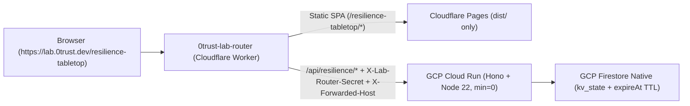
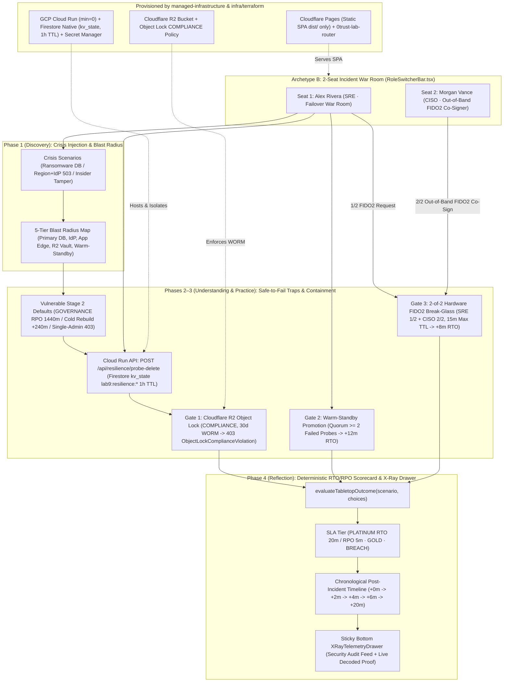

# Lab 9 Architecture: Chaos & Cyber Resilience Tabletop Simulator (`/resilience-tabletop`)

> **Zoom Level:** 2.5 (Lab Assembly + Infrastructure Mapping)  
> **Parent Overview:** [`0trust.dev/docs/ARCHITECTURE.md`](https://github.com/c2pig/0trust.dev/blob/main/docs/ARCHITECTURE.md)  
> **Experience Archetype:** Archetype B — 2-Seat Incident War Room (`SRE · Failover War Room` ↔ `CISO · Out-of-Band FIDO2 Co-Signer`)  
> **Architecture SVG:** [`docs/diagrams/resilience_tabletop_architecture.svg`](diagrams/resilience_tabletop_architecture.svg)  
> **Local Dev:** `http://localhost:5177` (Vite `/api` proxy → local Hono server on `:8080`)

---

## 1. Request Split & Runtime Topology

> **Route Prefix Note**: `0trust-lab-router` maps `/api/resilience/*` (not `/api/resilience-tabletop/*`) to the `0trust-lab-resilience-tabletop` Cloud Run service.

---

## 2. End-to-End 2-Seat War Room + `managed-infrastructure` Zoom-In

---

## 3. Distributed Repo & Infrastructure Ownership

| Lab Phase & Seat | Plain-English Purpose | Owning Application Repo | Provisioning Infrastructure |
| :--- | :--- | :--- | :--- |
| **Phase 1 (Discovery · Seat 1 SRE)**: Crisis Injection & Blast Radius | Simulate ransomware, region+IdP outage (`503`), or insider tamper across 5 infrastructure tiers | [`0trust-lab-resilience-tabletop`](https://github.com/c2pig/0trust-lab-resilience-tabletop) (`src/engine/resilienceTabletopEngine.ts`) | `managed-infrastructure/modules/cloudflare-pages-lab` (static `dist/` only, `enable_custom_domain = false`, behind `0trust-lab-router` at `https://lab.0trust.dev/resilience-tabletop`) + `infra/terraform` |
| **Phase 2 (Understanding · Cloud Run API)**: R2 Object Lock WORM Probe | Probe R2 immutability via `POST /api/resilience/probe-delete` (`200 R2_UNLOCKED_RISK` vs `403 ObjectLockComplianceViolation`) | [`0trust-lab-resilience-tabletop`](https://github.com/c2pig/0trust-lab-resilience-tabletop) (`server/runtime.ts`, `server/app.ts`, `server/kvAdapter.ts`, `functions/api/resilience/probe-delete.ts`) | `managed-infrastructure/modules/cloud-run-lab` (`min_instance_count = 0`) + GCP Firestore Native (`kv_state`, `1h TTL`) |
| **Phase 3 (Practice · Seat 1 SRE ↔ Seat 2 CISO)**: 2-of-2 FIDO2 Co-Sign & Failover | Harden vulnerable Stage 2 defaults, promote Warm-Standby (`quorum >= 2`), and co-sign 2-of-2 FIDO2 out-of-band | [`0trust-lab-resilience-tabletop`](https://github.com/c2pig/0trust-lab-resilience-tabletop) (`src/pages/ResilienceTabletopPage.tsx`, `src/hooks/useResilienceTabletop.ts`, `src/components/resilience/{WarRoomStatusBar,SreWarRoomSeat,CisoCosignerSeat,ExecutiveScorecardSection}.tsx`, `src/components/RoleSwitcherBar.tsx`) | Cloudflare Load Balancer + Hardware WebAuthn / FIDO2 |
| **Phase 4 (Reflection)**: Deterministic Scorecard & Sticky X-Ray Drawer | Compute RTO/RPO SLA (`PLATINUM` / `GOLD` / `BREACH`), chronological timeline (`+0m -> +20m`), and W3C `traceparent` proof | [`0trust-lab-resilience-tabletop`](https://github.com/c2pig/0trust-lab-resilience-tabletop) (`src/contracts/resilienceContract.ts`, `src/components/XRayTelemetryDrawer.tsx`) | `$0.00` Guided Sandbox + `_middleware.ts` OTLP Trace Context |

---

## 4. Cloud Run Backend, Security & Immutability Invariants

1. **Cloud Run Origin Auth & Health Probe (`server/runtime.ts`, `server/app.ts`, `server/index.ts`, `Dockerfile`)**:
   - Canonical multi-stage `node:22-alpine` container (`COPY src ./src` in Stage 1 builder; Stage 2 runner copies `/app/dist-server`, non-root `USER node`, port `8080`) running Hono + `@hono/node-server`.
   - `server/app.ts` is a thin wrapper delegating to canonical synced `server/runtime.ts` (`createBaseLabApp`, re-exporting `verifyRouterSecret`) and registering `POST /api/resilience/probe-delete`.
   - `GET /healthz`: Returns `200 { ok: true, lab: "resilience-tabletop" }` (exempt from `X-Lab-Router-Secret`; touches no secrets or Firestore).
   - **Fail-Closed Origin Auth & Runtime Hardening**: `LAB_ROUTER_SECRET` fails closed when unset or mismatched (`403 FORBIDDEN_DIRECT_ORIGIN`) using SHA-256 digest normalization + `crypto.timingSafeEqual` on `X-Lab-Router-Secret`; `server/origin.ts` enforces dev-only localhost origin fallback, `server/runtime.ts` uses bounded OTLP flush, and `server/index.ts` calls `closeIdleConnections()` on shutdown.
   - **Observability & Redaction (`functions/api/_middleware.ts`, `functions/api/_telemetry.ts`)**: Shares canonical OTLP/trace helpers from `_telemetry.ts` (with auth redaction), handles null-body responses, emits error telemetry, strips sensitive internal headers, propagates W3C `traceparent`, injects `_telemetry` and `X-Edge-Latency-Ms`, redacts JWT signatures in `Authorization`, never leaks `X-Lab-Router-Secret` or `OTLP_AUTH_HEADER`, and supports optional non-blocking OTLP trace export.
2. **Firestore Native State (`server/kvAdapter.ts`)**:
   - Stores session state in Firestore Native collection `kv_state` under document ID `resilience-tabletop:${encodeURIComponent(key)}` (key `lab9:resilience:<sessionId>`, `expirationTtl: 3600`) with **synchronous TTL enforcement on read** (`expireAt?.toMillis()` guard `<= Date.now()` returns `null`).
   - Automatically falls back to `MemoryKvAdapter` during local `npm run dev` when no GCP credentials are present.
3. **Vulnerable Stage 2 Safe-to-Fail Defaults**:
   - Stage 2 initializes in a vulnerable baseline (`R2_GOVERNANCE_OR_UNLOCKED`, `COLD_REBUILD`, `1` health probe, `SINGLE_ADMIN_BYPASS`) so learners can experience real failure modes (`HTTP 200 R2_UNLOCKED_RISK`, `HTTP 403 BREAK_GLASS_QUORUM_REQUIRED`, `SLA_BREACHED`) before hardening controls.
4. **Cloudflare R2 Object Lock (`COMPLIANCE` mode via `POST /api/resilience/probe-delete`)**:
   - Any `DELETE`, `BYPASS_GOVERNANCE`, or retention-shortening call when `COMPLIANCE` mode is active fails closed with **`403 ObjectLockComplianceViolation`** (`R2_IMMUTABILITY_HELD`, `RPO = 5m`).
5. **Warm-Standby Failover Quorum**:
   - Secondary region (`us-west-2`) promotion requires `>= 2` consecutive failed health probes, cutting regional recovery time from `+240m` (Cold Rebuild) to `+12m`.
6. **2-of-2 Out-of-Band FIDO2 Dual-Custody Break-Glass (IdP-Independent)**:
   - When the primary IdP is unreachable (`503`), single-actor bypass or a `1-of-2` SRE-only signature fails closed with **`403 BREAK_GLASS_QUORUM_REQUIRED`** (`BREAK_GLASS_DENIED`).
   - Valid break-glass requires **Seat 1 (SRE)** and **Seat 2 (CISO)** to co-sign (`2-of-2` hardware FIDO2/WebAuthn) with a **15-minute max TTL** (`+8m` RTO), emitting `BREAK_GLASS_INVOKED`.
7. **Deterministic RTO/RPO SLA Classification & Chronological Timeline**:
   - `PLATINUM`: `RTO <= 30m` (`20m`), `RPO <= 15m` (`5m`), `score >= 85` (`100/100`)
   - `GOLD`: `RTO <= 60m`, `RPO <= 60m`, `score >= 65`
   - `BREACH`: Any configuration failing Gold thresholds.
   - `post_incident_timeline` is strictly sorted by ascending `t_plus_minutes` (`+0m DETECTION` → `+2m CONTAINMENT (R2)` → `+4m CONTAINMENT (2-of-2 FIDO2)` → `+6m RECOVERY (Warm-Standby)` → `+20m VERIFICATION`).

---

## 5. CI/CD, Automated Hub Sync & Shell Parity
- **Split Deployment (`.github/workflows/deploy.yml`)**: `deploy-pages` runs `npm test && npm run build`, strips `functions/`, and uploads static `dist/` to Cloudflare Pages; `deploy-cloudrun` authenticates via GitHub Actions WIF OIDC, builds/pushes to Artifact Registry (`0trust-labs/resilience-tabletop:${GITHUB_SHA}`), and deploys to GCP Cloud Run.
- **Standalone Route**: Served at `https://lab.0trust.dev/resilience-tabletop` via `0trust-lab-router` (`c2pig/0trust.dev`).
- **Hub Dispatch (`.github/workflows/sync-to-hub.yml`)**: Fires a `repository_dispatch` (`event_type: lab_contract_updated`) to `c2pig/0trust.dev` whenever `lab.manifest.json` or `docs/diagrams/*.svg` changes on `main`.
- **Shared Shell & Runtime (`@0trust/lab-shell`)**: `RoleSwitcherBar.tsx`, `XRayTelemetryDrawer.tsx`, `src/shell/index.ts`, `src/index.css`, `functions/api/_middleware.ts`, `functions/api/_telemetry.ts`, `server/{kvAdapter,origin,runtime,index}.ts`, and `Dockerfile` are kept in parity with `c2pig/0trust.dev` via `scripts/sync-lab-shell.mjs`.
- **Terraform Remote State (`infra/terraform/backend.tf`)**: Declares remote `backend "gcs"` (`bucket = "0trust-dev-tfstate"`, `prefix = "labs/resilience-tabletop"`). `.terraform/` and `*.tfstate*` are gitignored. Operators migrating from local state should provision the GCS bucket once with Uniform Bucket-Level Access, object versioning enabled, and `public_access_prevention = "enforced"`, then run `terraform init -migrate-state`.

---

## 6. End-to-End Grafana Cloud Observability (OTLP `/v1/traces` + `/v1/logs`)
- **Middleware (`functions/api/_middleware.ts`) & Cloud Run (`server/app.ts`)**: Exports non-blocking OTLP/HTTP `/v1/traces` and `/v1/logs` spans via `waitUntil` with `OTEL_SERVICE_NAME=zerotrust-lab-resilience-tabletop` (resolved via `resolveServiceName(env)`), W3C `traceparent` 2-hop correlation (`0trust-lab-router` → `zerotrust-lab-resilience-tabletop`), pathname-only `http.target`, and strict JWT signature redaction (`0trust.redaction_applied`).
- **Secret Hygiene**: `OTLP_AUTH_HEADER` is mounted from GCP Secret Manager secret `grafana-otlp-auth-header` (per-secret `roles/secretmanager.secretAccessor` on `sa-lab-resilience-tabletop`) and is never logged or returned in responses.
- **X-Ray Drawer (`src/components/XRayTelemetryDrawer.tsx`)**: Includes the `"Global Live Dashboard ↗"` link to `https://0trust.dev/observability` alongside live `traceparent` and redaction proofs.

---

## Turnstile & 3-Minute Single-Session Lease Gate
- **Frontend Guard (`src/components/LabLeaseGuard.tsx`, re-exported via `src/shell/index.ts`)**: `src/App.tsx` wraps `<ResilienceTabletopPage>` with `<LabLeaseGuard labSlug="resilience-tabletop" labTitle="Chaos & Cyber Resilience Tabletop Simulator">`.
- **Edge Enforcement (`0trust-lab-router` + `LabLeaseDO`)**: Queries `GET /api/lease/resilience-tabletop/status`, renders the explicit Cloudflare Turnstile widget (`0x4AAAAAAGVF1oWC5CsFWn-J`) when available, acquires an `HttpOnly; Secure; SameSite=Lax` lease cookie (`lab_lease_resilience-tabletop`) via `POST /api/lease/resilience-tabletop/acquire` (180s hard cap, 25 calls/lease, 200 calls/UTC day), shows a countdown lock screen when occupied, and exposes a floating `MM:SS + End Lab` pill while active.
- **Zero Engine Changes**: All existing same-origin `/api/resilience-tabletop/*` requests carry the `HttpOnly` lease cookie automatically; local development (`localhost` / `127.0.0.1`) and disabled lease configs pass through transparently.

---

## Wave 1 Security & CI/CD Hardening
- **Canonical Shell & Runtime Parity**: Synced `src/components/LabLeaseGuard.tsx`, `functions/api/_middleware.ts`, `functions/api/_telemetry.ts`, and `server/{kvAdapter,origin,runtime,index}.ts` from `c2pig/0trust.dev`.
- **Bounded Ephemeral Fallback (`functions/api/resilience/probe-delete.ts`)**: `ephemeralResilienceStore` is strictly fallback-only when `STATE_KV` is unbound and enforces `3600s` TTL expiration + `256`-entry eviction.
- **CI & Deploy Gating**: Added `.github/workflows/ci.yml` (`pull_request` -> `main` running `npm ci`, `tsc --noEmit`, `tsc -p tsconfig.server.json --noEmit`, `npm test`, `npm run build`) and gated both `deploy-pages` and `deploy-cloudrun` in `.github/workflows/deploy.yml` on `needs: test-and-build`.

---

## Wave 2 IaC Pinning & Terraform CI
- **Immutable Module Pinning (`infra/terraform/main.tf`)**: Pinned all `c2pig/managed-infrastructure.git//modules/*` references (`cloudflare-pages-lab`, `cloud-run-lab`) to immutable tag `?ref=v1.0.0`, with multi-platform provider hashes (`linux_amd64`, `darwin_arm64`) committed in `infra/terraform/.terraform.lock.hcl`.
- **Remote GCS State (`infra/terraform/backend.tf`)**: Verified `backend "gcs"` (`bucket = "0trust-dev-tfstate"`, `prefix = "labs/resilience-tabletop"`) alongside `required_version = ">= 1.9.0"`, `cloudflare ~> 5.0`, and `google ~> 6.0`.
- **Terraform PR CI Validation (`.github/workflows/ci.yml`)**: Added a least-privilege `terraform-validate` job (`terraform_version: "1.11.4"`) executing `terraform fmt -check`, `terraform init -backend=false -input=false`, and `terraform validate` on every pull request targeting `main`.

- **X-Ray Telemetry Drawer Theme**: Uses Chrome DevTools Light Mode palette (`#ffffff` / `#f1f3f4` surfaces, `#dadce0` borders, `#202124` / `#5f6368` text, `#1a73e8` active indicators) for high-contrast readability.

---

## 3-Layer Unit Testing Architecture (`tsx --test` / `node:test`)
- **Layer 1 (`tests/server.test.ts`)**: Cloud Run Hono adapter, `X-Lab-Router-Secret` fail-closed `403`, `X-Forwarded-Host` validation, `MemoryKvAdapter` / `FirestoreKvAdapter` TTL, telemetry redaction, `413 PAYLOAD_TOO_LARGE`, and `400 INVALID_JSON`.
- **Layer 2 (`tests/api.test.ts`)**: Direct route testing of `functions/api/resilience/probe-delete.ts` with `MemoryKvAdapter` covering `GOVERNANCE`/`NONE` (`200`), `COMPLIANCE` (`403 R2_IMMUTABILITY_HELD`), `413`/`400` fail-closed validation, and per-session `STATE_KV` isolation.
- **Layer 3 (`tests/engine.test.ts`, `tests/selectors.test.ts`)**: Pure DOM-free UI selectors extracted to `src/engine/resilienceTabletopSelectors.ts` (wired into `src/hooks/useResilienceTabletop.ts`) and deterministic engine invariants in `src/engine/resilienceTabletopEngine.ts` (R2 Object Lock, 2-of-2 Break-Glass dual-custody, scorecard & post-incident report).

- **Lease-Boundary Lifecycle (`LabLeaseGuard`)**: Synced `src/components/LabLeaseGuard.tsx` with `onLeaseEnded?: () => void` callback invoked on **End Lab** (`handleRelease()`) and lease expiry transitions.
