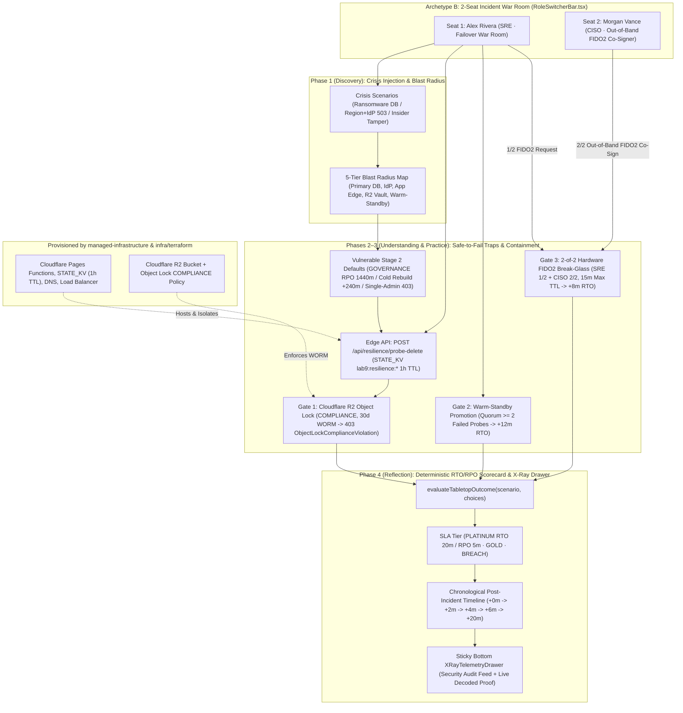

# Lab 9 Architecture: Chaos & Cyber Resilience Tabletop Simulator (`/resilience-tabletop`)

> **Zoom Level:** 2.5 (Lab Assembly + Infrastructure Mapping)  
> **Parent Overview:** [`0trust.dev/docs/ARCHITECTURE.md`](https://github.com/c2pig/0trust.dev/blob/main/docs/ARCHITECTURE.md)  
> **Experience Archetype:** Archetype B — 2-Seat Incident War Room (`SRE · Failover War Room` ↔ `CISO · Out-of-Band FIDO2 Co-Signer`)  
> **Architecture SVG:** [`docs/diagrams/resilience_tabletop_architecture.svg`](diagrams/resilience_tabletop_architecture.svg)

---

## 1. End-to-End 2-Seat War Room + `managed-infrastructure` Zoom-In

---

## 2. Distributed Repo & Infrastructure Ownership

| Lab Phase & Seat | Plain-English Purpose | Owning Application Repo | Provisioning Infrastructure |
| :--- | :--- | :--- | :--- |
| **Phase 1 (Discovery · Seat 1 SRE)**: Crisis Injection & Blast Radius | Simulate ransomware, region+IdP outage (`503`), or insider tamper across 5 infrastructure tiers | [`0trust-lab-resilience-tabletop`](https://github.com/c2pig/0trust-lab-resilience-tabletop) (`src/engine/resilienceTabletopEngine.ts`) | `managed-infrastructure/modules/cloudflare-pages-lab` (`enable_custom_domain = false`, behind `0trust-lab-router` at `https://lab.0trust.dev/resilience-tabletop`) + `infra/terraform` |
| **Phase 2 (Understanding · Edge API)**: R2 Object Lock WORM Probe | Probe R2 immutability via `POST /api/resilience/probe-delete` (`200 R2_UNLOCKED_RISK` vs `403 ObjectLockComplianceViolation`) | [`0trust-lab-resilience-tabletop`](https://github.com/c2pig/0trust-lab-resilience-tabletop) (`functions/api/resilience/probe-delete.ts`) | `managed-infrastructure` + Cloudflare R2 Object Lock + `STATE_KV` (`1h TTL`) |
| **Phase 3 (Practice · Seat 1 SRE ↔ Seat 2 CISO)**: 2-of-2 FIDO2 Co-Sign & Failover | Harden vulnerable Stage 2 defaults, promote Warm-Standby (`quorum >= 2`), and co-sign 2-of-2 FIDO2 out-of-band | [`0trust-lab-resilience-tabletop`](https://github.com/c2pig/0trust-lab-resilience-tabletop) (`src/pages/ResilienceTabletopPage.tsx`, `src/components/RoleSwitcherBar.tsx`) | Cloudflare Load Balancer + Hardware WebAuthn / FIDO2 |
| **Phase 4 (Reflection)**: Deterministic Scorecard & Sticky X-Ray Drawer | Compute RTO/RPO SLA (`PLATINUM` / `GOLD` / `BREACH`), chronological timeline (`+0m -> +20m`), and W3C `traceparent` proof | [`0trust-lab-resilience-tabletop`](https://github.com/c2pig/0trust-lab-resilience-tabletop) (`src/contracts/resilienceContract.ts`, `src/components/XRayTelemetryDrawer.tsx`) | `$0.00` Guided Sandbox + `_middleware.ts` OTLP Trace Context |

---

## 3. Security & Immutability Invariants Enforced

1. **Vulnerable Stage 2 Safe-to-Fail Defaults**:
   - Stage 2 initializes in a vulnerable baseline (`R2_GOVERNANCE_OR_UNLOCKED`, `COLD_REBUILD`, `1` health probe, `SINGLE_ADMIN_BYPASS`) so learners can experience real failure modes (`HTTP 200 R2_UNLOCKED_RISK`, `HTTP 403 BREAK_GLASS_QUORUM_REQUIRED`, `SLA_BREACHED`) before hardening controls.
2. **Cloudflare R2 Object Lock (`COMPLIANCE` mode via `POST /api/resilience/probe-delete`)**:
   - Session state is isolated in `STATE_KV` under `lab9:resilience:<sessionId>` with `expirationTtl: 3600` (`1h TTL`) and mirrored by a deterministic browser fallback for `vite dev`.
   - Any `DELETE`, `BYPASS_GOVERNANCE`, or retention-shortening call when `COMPLIANCE` mode is active fails closed with **`403 ObjectLockComplianceViolation`** (`R2_IMMUTABILITY_HELD`, `RPO = 5m`).
3. **Warm-Standby Failover Quorum**:
   - Secondary region (`us-west-2`) promotion requires `>= 2` consecutive failed health probes, cutting regional recovery time from `+240m` (Cold Rebuild) to `+12m`.
4. **2-of-2 Out-of-Band FIDO2 Dual-Custody Break-Glass (IdP-Independent)**:
   - When the primary IdP is unreachable (`503`), single-actor bypass or a `1-of-2` SRE-only signature fails closed with **`403 BREAK_GLASS_QUORUM_REQUIRED`** (`BREAK_GLASS_DENIED`).
   - Valid break-glass requires **Seat 1 (SRE)** and **Seat 2 (CISO)** to co-sign (`2-of-2` hardware FIDO2/WebAuthn) with a **15-minute max TTL** (`+8m` RTO), emitting `BREAK_GLASS_INVOKED`.
5. **Deterministic RTO/RPO SLA Classification & Chronological Timeline**:
   - `PLATINUM`: `RTO <= 30m` (`20m`), `RPO <= 15m` (`5m`), `score >= 85` (`100/100`)
   - `GOLD`: `RTO <= 60m`, `RPO <= 60m`, `score >= 65`
   - `BREACH`: Any configuration failing Gold thresholds.
   - `post_incident_timeline` is strictly sorted by ascending `t_plus_minutes` (`+0m DETECTION` → `+2m CONTAINMENT (R2)` → `+4m CONTAINMENT (2-of-2 FIDO2)` → `+6m RECOVERY (Warm-Standby)` → `+20m VERIFICATION`).
